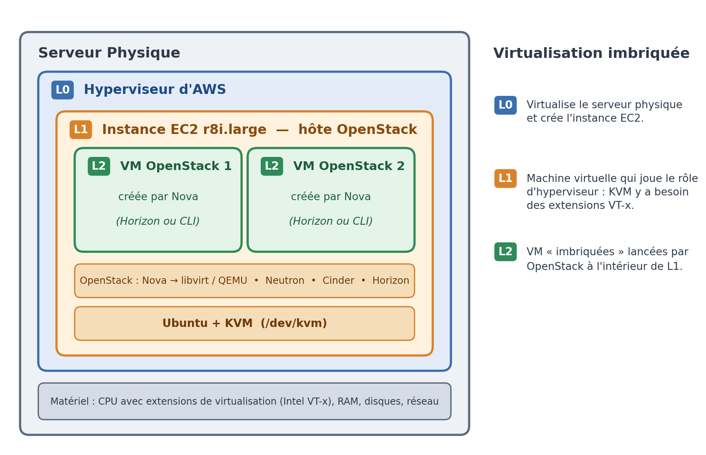
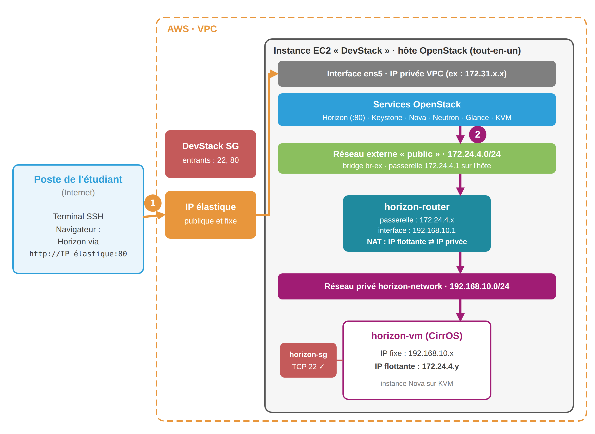

 

# TP01 — Déploiement et exploration d'une infrastructure OpenStack

## Objectifs du TP

- Installer et configurer une infrastructure OpenStack
- Créer et gérer une machine virtuelle avec l'interface graphique Horizon
- Créer et gérer une instance à l'aide de la CLI
- Accéder à une machine virtuelle déployée sur OpenStack
- Comprendre les bases de la gestion des ressources dans une infrastructure IaaS

> [!TIP]
> Les sections 1 et 2 sont détaillées pas à pas, avec des captures d'écran de la console AWS, dans le **[guide d'installation illustré](install-guide.fr.md)**.

---

## 1. Provisionnement de l'instance EC2

- **Nom** : `DevStack`
- **AMI** : Ubuntu **26.04 LTS**
- **Type d'instance** : `r8i.large` (2 vCPU, 16 Go de RAM)
- **Paire de clés** : créez une nouvelle paire de clés nommée `devstack`
- **Groupe de sécurité** : créez un nouveau groupe `DevStack SG` avec les règles suivantes :
  - SSH (port 22) — depuis n'importe où
  - HTTP (port 80) — depuis n'importe où
- **Stockage** : **50 Go**

> [!IMPORTANT]
> **Adresse IP élastique** : après le démarrage de l'instance, allouez une adresse IP élastique et associez-la à l'instance, pour garder une IP stable d'une séance à l'autre.

### 1.1. Vérification du support de la virtualisation

> [!NOTE]
> OpenStack ne virtualise pas lui-même. Son service de calcul Nova délègue la création des VM à l'hyperviseur KVM, et KVM s'appuie sur les extensions de virtualisation matérielle du CPU (Intel VT-x).
>
> Notre hôte OpenStack est déjà une machine virtuelle : l'instance EC2 tourne sur l'hyperviseur d'AWS. Pour que KVM fonctionne à l'intérieur, AWS doit exposer ces extensions à l'instance. C'est la **virtualisation imbriquée** (*nested virtualization*), désactivée par défaut.



Connectez-vous à votre instance EC2 via SSH :

```bash
ssh -i devstack.pem ubuntu@<IP_de_l_instance>
```

Vérifiez que le CPU expose les extensions de virtualisation :

```bash
lscpu | grep -i virtualization
```

Vérifiez que KVM est utilisable :

```bash
sudo apt update && sudo apt install -y cpu-checker
sudo kvm-ok
```

Si vous obtenez :

```
INFO: Your CPU does not support KVM extensions
KVM acceleration can NOT be used
```

activez la virtualisation imbriquée :

1. Arrêtez l'instance (**Stop**, pas *Terminate*) et attendez l'état *stopped*.
2. Sélectionnez l'instance EC2 : `Actions > Instance settings > Change CPU options > Nested virtualization > Enable`.
3. Redémarrez l'instance, reconnectez-vous et relancez `sudo kvm-ok`.

Résultat attendu :

```
INFO: /dev/kvm exists
KVM acceleration can be used
```

---

## 2. Installation de DevStack

1. Mettez à jour le système, puis redémarrez :

   ```bash
   sudo apt update
   sudo apt upgrade -y
   sudo reboot
   ```

   Attendez une minute, puis reconnectez-vous en SSH.

2. Installez les outils de base :

   ```bash
   sudo apt install -y git curl net-tools
   ```

3. Téléchargez DevStack :

   ```bash
   git clone https://opendev.org/openstack/devstack
   ```

4. Créez le fichier `local.conf` :

   ```bash
   cd devstack
   nano local.conf
   ```

   Copiez-collez le contenu suivant :

   ```ini
   [[local|localrc]]
   ADMIN_PASSWORD=secret
   DATABASE_PASSWORD=$ADMIN_PASSWORD
   RABBIT_PASSWORD=$ADMIN_PASSWORD
   SERVICE_PASSWORD=$ADMIN_PASSWORD
   ```

5. Lancez l'installation :

   ```bash
   ./stack.sh
   ```

---

## 3. Vérification des services

**Chargement des identifiants OpenStack :** avant d'utiliser la commande `openstack`, il faut charger dans le shell courant les variables d'environnement nécessaires.

```bash
cd ~/devstack
source openrc admin admin
```

| Élément | Rôle |
| --- | --- |
| `source` | Exécute le script `openrc` dans le shell courant, afin que les variables définies restent disponibles pour les commandes suivantes. |
| `openrc` | Script qui contient les informations d'authentification et de connexion à Keystone, le service d'identité d'OpenStack. |
| 1er argument (`admin`) | Nom de l'utilisateur OpenStack. |
| 2e argument (`admin`) | Nom du projet (*tenant*). |

Toutes les opérations passent par une commande unique : `openstack <service> <action> ...`. La commande `openstack --help` liste l'ensemble des services et actions disponibles.

```bash
# Services et endpoints
openstack service list
openstack endpoint list

# Compute
openstack compute service list
openstack hypervisor list

# Réseau
openstack network agent list
openstack network list
openstack subnet list

# Stockage
openstack volume service list
openstack volume list

# Images
openstack image list

# Instances
openstack server list
openstack server list --all-projects
```

---

## 4. Création d'une VM avec l'interface graphique Horizon

### 4.1. Accès au dashboard Horizon

- URL : `http://<IP_élastique_de_l_instance>`
- Utilisateur : `admin`
- Mot de passe : `secret` (valeur définie dans `local.conf`)

### 4.2. Création des ressources réseau, routage et sécurité

Dans cette partie, vous allez construire l'architecture réseau présentée dans le [schéma récapitulatif](#schéma-récapitulatif).

**Réseau et sous-réseau**

`Project > Network > Networks > Create Network` :

- Network Name : `horizon-network`
- Subnet Name : `horizon-subnet`
- Network Address : `192.168.10.0/24`

**Routeur**

Un réseau privé isolé ne peut pas joindre l'extérieur sans routeur.

`Project > Network > Routers > Create Router` :

- Router Name : `horizon-router`
- External Network : `public`

Ajoutez ensuite une interface reliant ce routeur au sous-réseau privé : `horizon-router > Interfaces > Add Interface`, puis sélectionnez `horizon-subnet`.

**Groupe de sécurité**

`Project > Network > Security Groups > Create Security Group` :

- Name : `horizon-sg`
- Add Rule : SSH (22)

**Paire de clés SSH**

`Project > Compute > Key Pairs > Create Key Pair` :

- Key Pair Name : `horizon-keypair`
- Key Type : SSH Key

Le fichier `.pem` est téléchargé automatiquement par le navigateur.

### 4.3. Création de la VM

`Project > Compute > Instances > Launch Instance` :

- Instance Name : `horizon-vm`
- Source : Image → `cirros`, avec `Create New Volume` = **No**
- Flavor : `m1.tiny`
- Networks : `horizon-network`
- Security Groups : `horizon-sg`
- Key Pair : `horizon-keypair`

### 4.4. Attribution d'une IP flottante

Une fois la VM active, elle n'est joignable que depuis le réseau privé `horizon-network`. Pour y accéder depuis l'hôte EC2, il faut lui attribuer une IP flottante (*floating IP*) issue du réseau externe `public` (généralement dans la plage `172.24.4.0/24`).

1. `Project > Network > Floating IPs > Allocate IP to Project` — Pool : `public`.
2. Dans `Project > Compute > Instances`, sur la ligne de `horizon-vm`, menu d'actions → **Associate Floating IP** → sélectionnez l'IP allouée → confirmez.

---

## 5. Connexion SSH à la VM depuis l'hôte EC2

**Transfert de la clé OpenStack vers l'instance EC2**

Depuis un terminal Windows (PowerShell), copiez la clé téléchargée à l'étape 4.2 vers l'instance EC2 :

```powershell
scp -i "C:\chemin\vers\devstack.pem" "C:\chemin\vers\horizon-keypair.pem" ubuntu@<IP_élastique_de_l_instance>:~/
```

Puis, sur l'instance EC2, restreignez ses permissions :

```bash
chmod 400 ~/horizon-keypair.pem
```

**Connexion à la VM OpenStack**

```bash
ssh -i ~/horizon-keypair.pem cirros@<IP_flottante_de_la_VM>
```

L'utilisateur par défaut de l'image CirrOS est `cirros`.

### Schéma récapitulatif



### Récapitulatif des composants réseau

| Composant | Exemple dans le TP | Rôle |
|---|---|---|
| **Réseau externe** | `public` (`172.24.4.0/24`) | Réseau qui relie OpenStack à l'extérieur. C'est de lui que proviennent les IP flottantes. |
| **br-ex** | pont sur l'hôte EC2 | Commutateur virtuel qui raccorde le réseau externe à l'hôte. Dans DevStack, il n'est relié à aucune carte physique : le réseau `public` n'est joignable que depuis l'hôte. |
| **Réseau privé** | `horizon-network` | Réseau virtuel isolé, propre au projet, sur lequel on branche les VM. |
| **Sous-réseau** | `horizon-subnet` (`192.168.10.0/24`) | Plage d'adresses IP du réseau privé. Il attribue automatiquement (DHCP) une IP fixe à chaque VM. |
| **Routeur** | `horizon-router` | Relie le réseau privé au réseau externe. Il permet aux VM de sortir vers l'extérieur et traduit les IP flottantes en IP privées (NAT). |
| **Passerelle externe** | `172.24.4.x` | Interface du routeur côté réseau externe. |
| **Interface du routeur** | `192.168.10.1` | Interface du routeur côté réseau privé. C'est la passerelle par défaut des VM. |
| **IP fixe** | `192.168.10.x` | Adresse privée de la VM, visible sur son interface réseau. Elle n'est joignable que depuis le réseau privé. |
| **IP flottante** | `172.24.4.y` | Adresse du réseau externe, associée à une VM. Le routeur la traduit en IP fixe (NAT 1:1). On peut la détacher et la réattribuer à une autre VM. |
| **Groupe de sécurité** | `horizon-sg` | Pare-feu appliqué à la VM. Tout le trafic entrant est bloqué, sauf ce qu'autorisent ses règles (ici : SSH, port 22). |
| **Paire de clés** | `horizon-keypair` | La clé publique est injectée dans la VM au démarrage. La clé privée (`.pem`) permet de s'y connecter en SSH sans mot de passe. |

> [!TIP]
> **À retenir :** pour qu'une VM soit accessible en SSH, il faut **les cinq éléments** : un réseau privé avec son sous-réseau, un **routeur** relié au réseau `public`, une **IP flottante** associée à la VM, un **groupe de sécurité** qui autorise le port 22, et une **paire de clés**.

---

## 6. Création d'une VM avec la CLI OpenStack

Chargez les identifiants OpenStack :

```bash
cd ~/devstack
source openrc admin admin
```

**Réseau privé et sous-réseau**

Créez le réseau `cli-network` et le sous-réseau `cli-subnet` :

```bash
openstack network create cli-network

openstack subnet create cli-subnet \
  --network cli-network \
  --subnet-range 192.168.20.0/24
```

**Routeur**

Créez un routeur, donnez-lui une passerelle externe sur le réseau `public`, puis reliez-le au sous-réseau `cli-subnet` :

```bash
openstack router create cli-router
openstack router set cli-router --external-gateway public
openstack router add subnet cli-router cli-subnet
```

**Groupe de sécurité**

Créez un groupe de sécurité avec une règle entrante SSH :

```bash
openstack security group create cli-sg
openstack security group rule create --protocol tcp --dst-port 22 cli-sg
```

**Paire de clés SSH**

Créez la paire de clés `cli-keypair` et enregistrez la clé privée :

```bash
openstack keypair create cli-keypair > cli-keypair.pem
chmod 400 cli-keypair.pem
```

**Lancement de la VM**

Récupérez d'abord le nom exact de l'image CirrOS, qui dépend de la version installée par DevStack :

```bash
openstack image list
```

Puis lancez la VM, en adaptant le nom de l'image si besoin :

```bash
openstack server create cli-vm \
  --image "cirros-0.6.3-x86_64-disk" \
  --flavor m1.tiny \
  --network cli-network \
  --security-group cli-sg \
  --key-name cli-keypair
```

Vérifiez l'état de l'instance (attendez `ACTIVE`) :

```bash
openstack server list
openstack server show cli-vm
```

**Allocation et association d'une IP flottante**

Allouez une IP flottante sur le réseau `public` :

```bash
openstack floating ip create public
```

Récupérez l'adresse allouée et associez-la à la VM :

```bash
openstack floating ip list
openstack server add floating ip cli-vm <IP_flottante>
```

**Connexion à la VM OpenStack**

```bash
ssh -i cli-keypair.pem cirros@<IP_flottante_de_la_VM>
```
